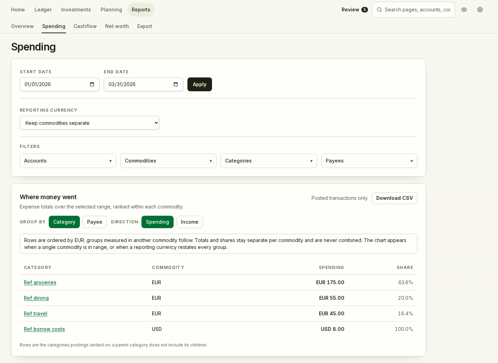

# Rekenraam

Rekenraam is a self-hosted personal finance app for tracking accounts,
transactions, budgets and investments across currencies. It is intended
primarily for a home lab or private network, and can also run on a local
computer or a VPS. You use it through a web browser on desktop or phone.

Your financial records live on the host you choose. You control the database,
backups and access to them, with no required external account or cloud storage.
Core bookkeeping works without bank or market-data connections. Optional
integrations make requests to the providers you configure.

It is a **pre-release, single-user project** maintained by one person, with
substantial use of AI to generate code and documentation. Features and data
structures are still changing.

*Rekenraam* is Dutch for abacus.



## What it does

- **Everyday bookkeeping:** accounts grouped by institution, categories,
  payees, split transactions and transfers. A double-entry ledger stores money
  as exact decimals; version history and statement reconciliation help you
  trace changes and compare balances with bank records.
- **Reports across currencies:** net worth, spending and cashflow with
  drill-down, charts and CSV downloads. Keep original currencies separate or
  convert reports using exchange rates you can inspect and edit.
- **Planning:** monthly budgets by category and currency, recurring
  transactions you review before posting, and projected balances based on
  recurring items and past spending.
- **Imports:** CSV with saved column profiles, QIF, duplicate detection and an
  optional Trading 212 connection for cash, trades and dividends.
- **Investments:** long and short positions, lots, dividends and reinvestment,
  transfers, splits, mergers, spin-offs and return of capital. Track realized
  and unrealized gains, compare FIFO, LIFO, average-cost and person-pooled
  methods, convert operational gains into a reporting currency, and save
  original-currency gains reports and period statements. Prices and exchange
  rates can be entered manually or fetched from optional providers.
- **Data portability and recovery:** ledger CSV, QIF and structured archive
  exports for analysis or migration; nightly verified backups and command-line
  restore for recovering the installation.
- **Access:** local sign-in with optional two-factor authentication and
  read-only API tokens for your scripts. The interface supports English and
  draft Dutch, German, French, Spanish and Russian translations.

The [feature ledger](docs/implemented.md) records what ships and the remaining
gaps in each area.

## Limitations and tradeoffs

- **Hosting takes maintenance.** You manage updates, HTTPS, storage protection
  and recovery. The app schedules and verifies backups, but you need to keep a
  copy on separate storage. Whole-database encryption is left to the host;
  connection credentials and two-factor secrets are encrypted by the app.
- **Still pre-release.** Updates apply migrations on startup, but there is no
  guaranteed upgrade path from every development revision. Some pre-release
  schema redesigns may require a development database reset; see the
  [upgrade policy](docs/upgrades.md).
- **One owner login.** You can track household finances, but there are no
  separate user logins or permissions for sharing the installation.
- **Connections cover specific providers.** Trading 212 is currently the only
  online bank/broker import connection; general bank sync is not available.
  Some events need manual entry or linking even though the corresponding
  investment operations are supported. Provider API keys or paid plans may be
  needed. OFX/QFX and XLSX file imports are not implemented.
- **Return analytics and tax automation are not included.** Cost-basis and
  gains reporting are available, but time-weighted and money-weighted returns
  are not yet implemented. Reports do not apply jurisdiction-specific tax
  rules or prepare tax filings.
- **No attachments.** Statement PDF and receipt storage are outside the current
  scope.
- **Translations need native review.** The five non-English catalogs are
  glossary-based drafts; financial terminology has not yet been signed off by
  native reviewers.

## AI use and review

AI-generated code and documentation are part of the development process.
Using the app does not require an AI account or sending your records to an AI
service.

Changes go through repeated code reviews, regression tests and recorded audits
of areas such as ledger calculations, reconciliation, authentication and
backup/restore. The [review records](docs/reviews/) describe their scope,
findings and validation; the [roadmap](docs/roadmap.md) retains release gates
and follow-up work.

As of 22 October 2026, the repository has more than 1,000 commits. That is a
record of development activity, not a count of independent reviews or a
guarantee of correctness. Bugs have been found through these reviews and may
remain despite them.

## Try it

The Docker Compose example builds the app from source. Generate a random setup
token of at least 32 characters; you'll enter it in the browser to create the
owner account.

```sh
export SETUP_TOKEN="$(openssl rand -hex 32)"
docker compose -f deploy/docker/compose.yaml up --build
```

Then open <http://127.0.0.1:16888>. The example only listens on localhost.

Before storing financial data:

- Set `REKENRAAM_SECRET_KEY` to a durable secret before connecting online
  providers or turning on two-factor sign-in, and keep it somewhere other than
  your backups.
- For access from other devices, put it behind HTTPS. The
  [deployment security guide](docs/deployment-security.md) walks through it.
  Enrol in two-factor sign-in before exposing it to the internet.
- Read the [upgrade and restore guide](docs/upgrades.md) before upgrading an
  installation you care about.

Quote providers are optional and require your own API key: set
`COINGECKO_DEMO_API_KEY` or `TWELVE_DATA_API_KEY`, then assign them to
instruments under Investments → Instruments. Details are in the
[quote provider notes](docs/plans/quote-providers-crypto-plan.md).

## Backups and exports

Use a backup to restore Rekenraam. Exports are for use outside the app.

- **Backups** (Settings → Data → Backups) contain the database, including the
  ledger, investments, budgets, recurring items, reconciliations and settings.
  Rekenraam makes one every night and on request, and verifies each before
  keeping it. The separate `REKENRAAM_SECRET_KEY` is not included; retain it
  to recover encrypted connection and two-factor secrets. Stop the app before
  restoring with `rekenraam restore --from <backup>`, following the
  [restore guide](docs/upgrades.md).
- **Exports** (Settings → Data → Export) are ledger CSV, QIF, or a full archive
  for spreadsheets and other finance tools. They are for reading elsewhere and
  **cannot be imported back** into Rekenraam as a restore.

## Development

The backend is Go with SQLite, the frontend is SvelteKit, and production is a
single Go binary that serves the built frontend.

You'll need Go 1.27.3+ (with CGO and a C compiler, e.g.
`sudo apt install build-essential`), Node 24 and the pnpm version pinned in
`package.json`.

```sh
pnpm install
pnpm dev          # http://localhost:1888, API proxied to 127.0.0.1:16888
```

Checks and build:

```sh
./scripts/test-backend.sh      # gofmt, vet, race tests
./scripts/test-frontend.sh     # catalog parity, API types, Svelte checks, unit tests
./scripts/test-e2e-smoke.sh    # provider stub tests + browser smoke suite
pnpm build                     # writes dist/rekenraam
```

The separate public website is in [`website/`](website/README.md). It has no
backend or npm dependencies and builds complete pages in the app's six languages:

```sh
pnpm website:dev              # http://127.0.0.1:1889
pnpm website:check            # translation and static-output checks
pnpm website:build            # writes website/build; does not publish
```

Browser checks, screenshot capture and manual GitHub Pages setup are documented
in [Public website](docs/developer-workflow.md#public-website).

The full browser suite is `./scripts/test-e2e.sh`. Focused Go commands, Go cache
settings, E2E timing, the API contract audit, resetting a disposable dev
database and local password recovery are documented in the
[developer workflow](docs/developer-workflow.md).

Release preparation uses a manual Linux amd64/arm64 candidate workflow with
Sigstore keyless signing; it does not publish a release. Local packaging starts
with `./scripts/build-release-candidate.sh v0.1.0-rc.1 amd64 dist/candidate-linux`
from a clean committed Linux checkout. Candidate download verification and
the remaining release gates are documented in
[Release candidates](docs/developer-workflow.md#release-candidates-333).

| Path | What's there |
|---|---|
| `backend/` | Go server, services, SQLite migrations, tests |
| `frontend/` | SvelteKit app, compiled for embedding |
| `website/` | Public project website, built separately as static HTML |
| `api/` | OpenAPI contract and Bruno requests |
| `e2e/` | Playwright browser journeys |
| `deploy/` | Docker build and Compose example |
| `scripts/` | Dev, validation and build commands |
| `docs/` | Requirements, decisions, plans and status |

Start with the [documentation map](docs/README.md). The
[roadmap](docs/roadmap.md) sets the work order, open work is tracked in
[GitHub Issues](https://github.com/sergeyfarin/rekenraam/issues), and product
and architecture decisions live in the
[requirements](docs/product-requirements.md),
[conventions](docs/conventions.md) and [ADRs](docs/adrs/). Security reports go
through [SECURITY.md](SECURITY.md).

## License

[AGPL-3.0](LICENSE).
